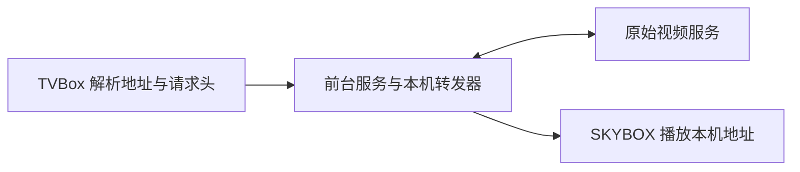

# TVBox Skybox Bridge


让指定版本的 TVBox 将点播视频交给 **SKYBOX VR Video Player** 播放，支持保留请求头、本机视频转发和播放诊断。

**本项目新增的适配功能由 AI（OpenAI Codex）完成开发、修复、测试和文档编写。用户提出需求，并在真实设备上确认 v2 已能播放。** 原版 TVBox 与 SKYBOX 均为第三方项目，其原有功能不属于本项目的 AI 开发成果。详见 [AI 开发说明](AI_DISCLOSURE.md)。

## 使用

从本仓库 [Releases](https://github.com/MuMuYAaaa/tvbox-skybox-bridge/releases) 下载 `TVBox-Skybox-Bridge-v0.2.0-arm64.apk`，安装到与 SKYBOX 相同的 Android / Quest 设备。

1. 应用名称是 **TVBox SKYBOX**，与原版 TVBox 分开安装。
2. 已安装此前修改版的用户可直接覆盖升级 v2，保留接口配置；首次安装需要填入自己的接口地址。
3. 播放影片时，长按播放控制栏的“EXO播放器”或当前播放器名称，选择 **SKYBOX（外部播放）**。也可在设置的“播放器”选项中设为默认。
4. 播放期间保持 TVBox 在后台运行，它负责向 SKYBOX 提供视频数据。
5. 若播放失败，返回 TVBox 查看“SKYBOX 播放诊断”，或点击视频转发通知查看。通知中可停止转发。

## 已确认可用

| 项目 | 结果 |
| --- | --- |
| 设备 | Meta Quest 3S |
| SKYBOX | 官方商店版本 1.2.2 |
| 修改版 | v0.2.0 / skybox2 |
| 实机验证 | 用户于 2026-11-26 反馈“已经可以播放了” |
| HTTP 转发测试 | 16 项真实本地 HTTP 集成测试通过 |
| 外播接口测试 | 10 组 Android API 模拟测试通过 |
| 安装包校验 | DEX、ZIP、对齐及 APK v1/v2/v3 签名通过 |

实机结果由用户反馈；AI 未直接操作头显。其他设备、片源与编码需要各自验证。

## 为什么需要转发

直接唤起 SKYBOX 只解决了应用跳转。TVBox 已解析的视频可能还依赖 `Referer`、`User-Agent`、`Cookie` 等请求头。第一版只传递地址和标题，遗漏了这些请求头，用户反馈跳转后无法播放。

v2 将 TVBox 解析出的请求头交给本机 HTTP 转发器，由 TVBox 负责取流，再把本机地址交给 SKYBOX。转发器还会改写 M3U8 的分片、子列表和密钥地址，让这些请求继续经过同一取流链路。



转发器仅监听 `127.0.0.1` 随机端口，路由带随机会话标记；支持 HTTP 重定向、Cookie、Range/206、HEAD、M3U8 多级列表和 URI 属性。诊断显示状态码、类型和请求数量，不记录视频地址参数或请求头值。

## 适配范围

补丁精确适配以下用户提供的原始安装包：

```text
TVBox_q215613905_20261111-1518-java64.apk
SHA-256: c3aee40419fe9cef88dbac99aa7aff6e26503f8fb5e3dd1dd07e46e8e28b3c02
```

应用包名为 `com.github.tvbox.osc.jun.skybox`，最低 Android 5.0，发布包保留原包的 ARM64 架构。补丁依赖该版本的具体类与方法，不会自动适配其他 TVBox 构建。

本次接入点播外部播放，未修改直播；未实现 DASH 清单改写、DRM、网页验证、外部自动连播或播放进度回传。SKYBOX 仍须支持视频自身的格式和编码。

## 源码与构建

仓库包含新增 Java 源码、定向补丁、构建脚本和测试；原始 APK、完整反编译目录、第三方工具及签名密钥不进入 Git。

构建需要 Windows、Python 3.10+、JDK 17 或 18、Android SDK Platform 34 / Build Tools 34.0.0，以及 [官方 Apktool 3.0.3](https://github.com/iBotPeaches/Apktool/releases/tag/v3.0.3)。

```powershell
.\build.ps1 `
  -InputApk 'C:\input\TVBox_q215613905_20261111-1518-java64.apk' `
  -ApktoolJar 'C:\tools\apktool_3.0.3.jar' `
  -JdkDirectory 'C:\Java\jdk-18' `
  -AndroidSdkDirectory 'C:\Android\Sdk'
```

输出位于 `dist/`。首次构建会在已忽略的 `signing/` 目录生成本地密钥；后续构建复用它。需要使用已有签名时，传入 `-Keystore`、`-PasswordFile` 和可选的 `-KeyAlias`。自建密钥与已安装应用签名不同时，不能覆盖安装。

仅运行测试不需要 APK 或 Android SDK：

```powershell
$env:JAVA_HOME = 'C:\Java\jdk-18'
python tests/test_handoff.py
python tests/test_stream_relay.py
```

## 版本记录与来源

参见 [更新记录](CHANGELOG.md)、[v0.2.0 发布说明](release/v0.2.0.md) 和 [校验记录](release/validation.json)。

外部播放调用参考了 [Kazumi 的 Android 实现](https://github.com/Predidit/Kazumi/blob/main/android/app/src/main/kotlin/com/example/kazumi/MainActivity.kt)。本项目是独立适配项目，与 TVBox、SKYBOX 官方没有隶属关系。
